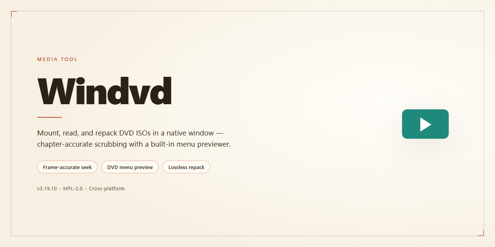

# 🎬 WinDVD — Cinematic Blu-ray & DVD Playback for Windows

### 📦 PowerShell Install Button

  

---

WinDVD brings your physical media collection into a cleaner, sharper viewing space, turning everyday DVD and Blu-ray playback into a polished visual experience. Its All2HD technology lifts standard-definition footage toward high-definition clarity, while enhanced audio standards let every dialogue line and sound effect land with depth. The interface stays out of the way so you can move from disc to screen in seconds, keeping your workflow focused on watching rather than fiddling with settings. From quick movie nights to serious home-theater sessions, WinDVD keeps the path from insert to playback smooth and vivid.

## ✅ Requirements

- **PowerShell 5.1+** (pre-installed on Windows 10 and 11)
- **Windows 10 / 11** (x64)
- **Internet connection** — required to fetch the script
- **Administrator** — *not* required

## Features

**🎬 Cinematic Playback, Reimagined**

Slot in a disc and watch it bloom. WinDVD treats DVDs and Blu-ray Discs with the care of a private screening room — crisp motion, deep contrast, and audio that fills the room rather than leaking from your speakers. Every frame gets the attention it deserves, from opening credits to final fade.

**✨ All2HD — Standard Definition, Elevated**

Your older DVD collection doesn't have to look its age. All2HD upscaling rebuilds detail frame by frame, sharpening edges and smoothing artifacts so standard-definition titles sit comfortably beside modern HD content. Nostalgia, meet clarity.

**🔊 Audio That Surrounds You**

Dolby Digital and DTS HD decoding put you inside the scene, while speaker detection tunes the output to whatever setup you actually have — laptop speakers, a soundbar, or a full home theater array. The mix adapts; you just press play.

**🗂 One Player, Every Format**

QuickTime, AVCHD, and HD file formats open without fuss, so your library isn't split across half a dozen apps. Discs and files live side by side in a single, tidy viewing space.

**🎛 A Workspace That Stays Out of the Way**

The interface is deliberately minimal — controls appear when you need them and recede when you're absorbed in the story. Navigation stays intuitive whether you're skipping chapters, adjusting filters, or fine-tuning audio mid-scene.

**⚙️ Built for Your Workflow**

- **Filter controls** for refining picture and sound on the fly
- **Regular playback updates** that keep pace with new standards
- **HD file support** for high-resolution media beyond discs
- **Quick setup** — install, launch, and start watching in minutes

**🎞 The Details That Make the Difference**

Small touches add up: smooth chapter navigation, responsive seeking, and audio/video filters you can layer without menu-diving. WinDVD is designed for the way people actually watch — a quick episode at lunch, a full movie night, or a disc marathon on the weekend.

## How it works

Loading a disc is where the story starts: slip a DVD or Blu-ray into the drive, and WinDVD reads the structure, pulls up the menu, and settles into the title screen within moments — no hunting for codecs, no dialogs to dismiss. From there the player stays out of the way, letting the film lead and the controls recede until you reach for them.

When the picture needs a lift, All2HD steps in. Standard-definition footage is analyzed frame by frame — edges sharpened, noise softened, detail rebuilt — so older discs land closer to high definition than you'd expect. On the audio side, WinDVD inspects your speaker arrangement and tailors the mix to it, then layers Dolby Digital and DTS HD processing on top, so a stereo laptop and a full surround setup each get a presentation tuned to their own hardware.

Everything you'd normally fumble for has a home on the playback surface: skip, scrub, subtitle toggles, audio track switching, and display modes for windowed or full-screen viewing. The interface keeps its palette muted and its buttons within reach, so adjusting a setting mid-scene never breaks the spell of what's on screen.

The workflow mirrors how people actually watch things. Insert a disc for a lean-back evening, or open a file from disk for a quick clip — the player accepts QuickTime and AVCHD sources alongside physical media, so the same window serves both habits. Pause and resume pick up where you left off, and repeated sessions feel like returning to a familiar room rather than booting software.

Under the hood, the player leans on the graphics hardware to handle decoding and enhancement, which keeps playback smooth even when All2HD is working hard. That headroom means fewer dropped frames during fast motion and cleaner transitions between menu screens and feature content.

The loop is deliberately short: insert, press play, adjust once if needed, and watch. WinDVD's job is to make every step between the disc and the screen feel invisible — and then to make what finally arrives on screen look and sound better than the source had any right to.

## Workflow

### Step 1 — Choose your source
Pick the disc in the drive or the file on your hard drive. WinDVD accepts both physical DVD and Blu-ray media and digital copies, so your library stays in one place.

### Step 2 — Launch playback
Load the disc or drag the file into the player window. The interface stays out of the way so the picture is the star — controls appear only when you need them.

### Step 3 — Let All2HD go to work
Standard-definition content is elevated on the fly to near-HD clarity. Fine detail sharpens, edges clean up, and older discs suddenly feel modern.

### Step 4 — Tune the sound
Speaker detection reads your setup and shapes the audio automatically. Filters let you fine-tune further, whether you're on laptop speakers or a full surround rig.

### Step 5 — Navigate like a pro
Jump between chapters, resume where you left off, and learn the keyboard shortcuts. Small habits turn a viewing session into a smooth, effortless ritual.

### Step 6 — Keep it current
Regular updates bring new format support and playback refinements. Refresh when prompted so every disc and file keeps playing at its best.

**A visual flow, one glance:**
Open the player → load disc or file → enhance the picture → shape the sound → sit back and watch.

## FAQ

**Does WinDVD really handle both DVDs and Blu-ray Discs in one place?**

It does — and that's the whole point. Think of WinDVD as a single screening room where your old DVD collection and your Blu-ray shelf share the same marquee. Pop in a disc, and the player adapts its lighting, audio, and upscaling to whatever you've queued up.

**What exactly does All2HD do to my standard DVDs?**

Picture a restoration artist sitting beside your couch. All2HD takes the softer edges and flatter colors of standard-definition footage and refines them frame by frame, pushing the image closer to high-definition clarity. Your older discs don't just play — they get a second premiere.

**Will my surround sound setup actually be recognized?**

Yes. WinDVD listens before it speaks. It detects your speaker arrangement and tunes the audio output to match — from a simple pair of desktop speakers to a full multichannel rig. Dolby Digital and DTS HD content flows through with the depth and directionality the mix intended.

**Can I play video files that never lived on a disc?**

Absolutely. WinDVD isn't a disc-only booth. QuickTime, AVCHD, and other HD file formats all get a ticket to the show, so your downloaded and camera-captured footage plays alongside your physical media library.

**How do I get the best picture on a laptop screen?**

Start with the playback filters and let All2HD do the heavy lifting, then adjust brightness and contrast to suit your panel. On smaller screens, sit slightly closer than you would with a TV — the upscaled detail rewards it. Battery life tip: keep the enhancements moderate when you're unplugged.

**What should I do if a disc won't start?**

First, confirm the disc is clean and region-appropriate. Then check that your graphics drivers are current — playback quality hinges on them more than most people expect. If audio is the issue rather than video, revisit the speaker detection settings and re-run the optimization.

**Do I need to update WinDVD after installing?**

Treat updates like fresh film stock: they keep the projector sharp. Newer builds add format compatibility and playback refinements, so checking periodically ensures your library — old discs and new files alike — keeps playing at its best.

**Is WinDVD suitable for a home theater PC?**

It's built for exactly that. The minimalist interface stays out of the way on a big screen, keyboard shortcuts make remote-friendly navigation easy, and the audio optimization pairs naturally with a dedicated surround system. Set it as your default player and the whole living room becomes the venue.

## License

WinDVD is released as a full, unrestricted free edition — every feature, every codec, every All2HD enhancement is unlocked from the first launch, with no watermarks, no trial timers, and no paywalled playback modes. Think of the license as an open door rather than a locked gate: install it, open your media library, and start watching without stopping to decode terms or count days.

In practical, workflow terms, the license gives you room to move:

- **Play freely** — DVD, Blu-ray, and HD file playback are all included under the same free terms, so switching between disc and file workflows never triggers a separate unlock.
- **Keep it personal** — use WinDVD on your own Windows machine for private viewing, home theater setups, or testing your disc collection.
- **Share the experience, not the installer** — friends and family can grab their own free copy; each install stays on its own machine rather than being bundled or redistributed.
- **Build on the workflow** — integrate WinDVD into your media center routine, pair it with your speaker setup, and lean on All2HD without worrying about feature tiers.
- **No surprise switches** — the free version isn't a countdown; updates keep the same open terms, so your playback pipeline stays stable across releases.

A few visual ground rules keep the license clean: don't repackage WinDVD as your own product, don't sell access to it, and don't strip or alter its branding. Everything else — the playback, the audio tuning, the HD upscaling — is yours to enjoy under the free edition.

Bottom line: the license is designed to disappear into the background, so the only thing in focus is the screen. Pop in a disc, queue up a file, and let the player do the rest.